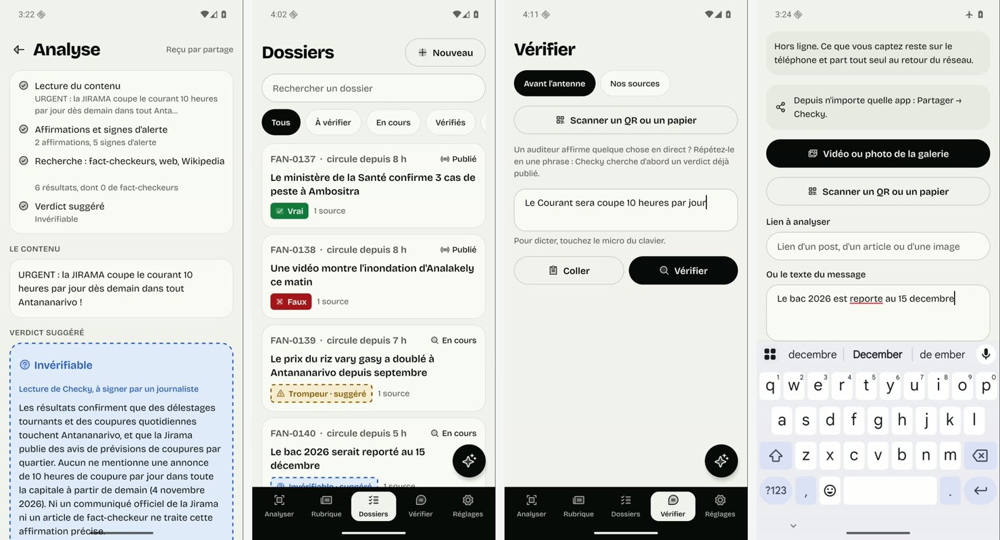

<div align="center">


# Checky mobile

**Share a rumour to Checky, get the proof.** The Android app for journalists and citizens in Madagascar.

[](https://checky-mg.vercel.app)


**[Platform (web + API)](https://github.com/0nlyDevs/checky-platform)** · **[Browser extension](https://github.com/0nlyDevs/checky-extension)** · **[Full reference](docs/REFERENCE.md)**

</div>

---



## What it does

A video, photo, voice note or link received on WhatsApp, Facebook or TikTok goes through **Partager → Checky**. The app then uploads the file, transcribes what is said, picks out the claims and warning signs, searches fact-checkers, the web and Wikipedia, and suggests a verdict that quotes its sources. **A journalist always confirms the verdict**, and one tap follows the claim in the newsroom's desk.

| Feature | Details |
|---|---|
| **Share to Checky** | Android share sheet for text, images, video, audio and PDF. Up to 10 screenshots at once are grouped by rumour. |
| **Selection menu in any app** | Select a sentence anywhere: *Checky*, *Traduire FR ↔ MG* or *Remplacer par le démenti* (a native `PROCESS_TEXT` module). |
| **Background checks** | A check keeps running while you go back to your app, with a foreground service and a notification when the reading is ready. |
| **Clipboard offer** | « Vérifier ce que vous venez de copier ? » when Checky opens with a link or a sentence in the clipboard. |
| **Avant l'antenne** | A caller's claim, typed or dictated, is matched against published verdicts, with a two-sentence radio line to read on air. |
| **Newsroom desk** | Claims by status, verdict confirmation (icon + label, never colour alone), AI source analysis, comments, *Partager le verdict* as a 1080 × 1080 card in French or Malagasy. |
| **Ma rubrique, annuaire, chiffres** | What circulates for your beat, who to call, official figures: a copy stays on the phone. |
| **Seal scanner** | Check the QR seal of a verdict or communiqué against saved keys **without a network**. |
| **Citizen mode** | No account: check a shared post against published verdicts (*Est-ce déjà vérifié ?*), send a tip to a newsroom, follow it, pass a verdict on. |
| **Assistant** | The same assistant as the web desk, with dictation and read-aloud. |
| **Hard conditions** | Offline queue (*À envoyer*), cached reading, *Mode léger* for slow connections, interface in Malagasy, French and English. |

The AI only **suggests** (dashed outline); a confirmed verdict is solid. A citizen never sees an AI verdict, only verdicts that a verified newsroom signed.

## Tech stack

| Layer | Technologies |
|---|---|
| **App** | Expo SDK 58, React Native 0.88, React 19, TypeScript, Expo Router |
| **Native (Android)** | A local Expo module in Kotlin: selection-menu activity and aliases, foreground service for background checks |
| **Sharing and device** | expo-share-intent, expo-camera (QR), expo-image-picker, expo-clipboard, expo-notifications, expo-background-task, expo-audio, expo-speech |
| **Data** | SWR kept on disk, an offline outbox, saved keys and registry for offline seals |
| **Auth** | Better Auth through its Expo plugin, session in SecureStore, short-lived JWT for the API |
| **Backend** | The [Checky API](https://github.com/0nlyDevs/checky-platform): FastAPI, PostgreSQL, AI gateway |

## Quick start

You need Node 22+, JDK 17 and the Android SDK, plus a running [checky-platform](https://github.com/0nlyDevs/checky-platform) (web on :3000, API on :8000).

```bash
npm install
npx expo prebuild --platform android   # generates android/ (gitignored)
adb reverse tcp:3000 tcp:3000 && adb reverse tcp:8000 tcp:8000
npm run android                         # builds, installs and starts Metro
```

Point the app at a deployed backend with `EXPO_PUBLIC_WEB_URL` and `EXPO_PUBLIC_API_URL`, set before `expo start`. Standalone APK, release build notes and every environment variable are in the [reference](docs/REFERENCE.md#setup).

```bash
npx tsc --noEmit && npx eslint src index.ts modules && npm test   # checks
```

## Documentation

- [`docs/REFERENCE.md`](docs/REFERENCE.md): every screen, languages, share and selection menus, offline behaviour, project layout, setup, checks and the backend routes the app relies on
- [`AGENTS.md`](AGENTS.md): conventions for contributors and coding agents

## About

Part of **Checky**, built by team **OnlyDevs** (students at HEI) for the **FANILO Hackathon**, organised by **IFM** and **42** in Antananarivo, 2 to 4 November 2026. Every rumour shown as an example is fictional and labelled.
